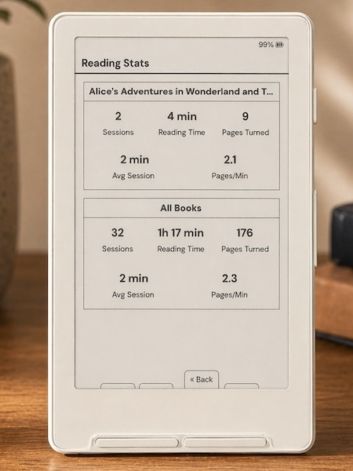

> **This is a personal fork of [CrossPoint Reader](https://github.com/crosspoint-reader/crosspoint-reader)** with a focus on improved fonts and minimal reading stats.

### Supported Devices

- Xteink X3
- Xteink X4
- Xteink X4 Pro
- Xteink X4 Classic
- Seeed Studio Sticky

## What's different in this fork

My goal with this fork was to maintain the core Crosspoint firmware while integrating my preferred typography and some lightweight reading statistics. I’ve focused on keeping the underlying system stable while layering in a few "nice-to-have" features and UI refinements along the way.

<table>
  <tr>
    <td align="center">
      <br/>
      <em>Font: Bitter, Size: 12 pt, Margin: 15</em>
    </td>
    <td align="center">
      <br/>
      <em>Reading Stats with custom front button mapping shown</em>
    </td>
  </tr>
</table>

### Highlights

- Editable SD language files with persistent caching. See [language setup and translation instructions](docs/languages.md).
- New reader fonts: Lexend Deca and Bitter.
- Music notation and selected supplemental Unicode glyph support to be able to render Project Hail Mary accurately.
- Added a custom `Minimal` theme and sleep screen option for the minimalists out there.
- Added a custom `Dashboard` theme and sleep screen option for reading stats enthusiasts.
- Reader font sizes: 10 to 16 pt built in on Xteink X3/X4. X4 Classic, X4 Pro, and Sticky use scalable fonts with 1 pt steps from 8 to 22 pt.
- Added ~~strikethrough~~ support.
- Made <u>underlines</u> thicker for better visibility.
- Added support for `<hr>` section breaks.
- Added support for "redaction" style rendering.
- Added improved support for tables with simple markup.
- Added ability to add bookmarks.
- Added ability to remap front buttons that only applies in the reader.
- Added Focus Reading and Guide Dots as optional reader modes.
- Added Force Paragraph Indents for books that render as one giant wall of text.
- Added ability to pin a sleep image as a favorite. The favorited image will always be displayed when your sleep settings are set to `Custom` or `Cover + Custom` (when no cover is available).
- Added more in-reader control remapping options for side buttons, short power button clicks, and long-press menu actions, and more.
- Added ability to mark a book as finished from the in-book menu. A pop-up will also display once 99% of the book is reached. This status allows tracking of total books read.
- Added ability to move finished books to "Read" folder.
- In-book menu to quickly adjust reader options without having to exit the book.
- Reading stats: total books read, total reading time, number of sessions, pages turned, average session time, pages turned per minute. You can also set your reading stats as your sleep screen.
- All-time reading stats [syncing](./docs/reading-stats-sync.md) between two CrossInk devices.
- Reading [progress sync](./docs/nearby-position-sync.md) between two CrossInk devices.
- Added customizable Auto Page Turn Interval (anything between 5-120 seconds).
- A Library screen that lists every book on the SD card, with search, sorting, and a list or cover grid view for recently opened books.
- To view a more detailed list for each version, visit the [releases](https://github.com/uxjulia/CrossInk/releases) page to read release notes.

---

### Reader Fonts

The default fonts have been replaced with Lexend Deca and Bitter. These fonts have been chosen specifically to improve reading fluency and e-ink performance. These 'sturdier' typefaces feature uniform stroke weights and open geometries, allowing the X4/X3 to render crisp, high-contrast text with font-aliasing on while significantly reducing ghosting and artifacts.

- [Lexend Deca](https://fonts.google.com/specimen/Lexend+Deca) - A research-backed sans-serif typeface designed to improve reading fluency. Lexend was engineered based on the theory that reading issues are often a design problem (visual crowding) rather than a cognitive one.
- [Bitter](https://fonts.google.com/specimen/Bitter) - A "contemporary" slab serif typeface for text, it is specially designed for comfortably reading on digital screens. The consistent stroke weight of Bitter helps it render particularly well on e-ink devices. The medium weight has been chosen specifically for improved rendering on the X4/X3.

The UI now uses [Inter](https://fonts.google.com/specimen/Inter) as the display font which has improved readability at smaller sizes.

### Music and Supplemental Glyphs

- Built-in reader fonts include music notation, selected Cyrillic glyphs, and the Project Hail Mary CJK fallback ranges. Additional SD-card fonts retain emoji fallback support.

---

### Font Sizes

- Xteink X3 and X4: built-in reader font sizes are 10 pt, 12 pt, 14 pt, and 16 pt.
- X4 Classic, X4 Pro, and Sticky: Lexend Deca and Bitter are scalable, so you can pick any size from 8 pt to 22 pt in 1 pt steps.

See [SD Card Fonts](./docs/sd-card-fonts.md) for installing additional font families and size ranges.

---

### Reader features

Reader Options, Focus Reading, Guide Dots, Force Paragraph Indents, reading stats, and finished-book behavior are documented in [Reader Features](./docs/reader-features.md).

### Custom button actions

CrossInk adds configurable button shortcuts.

See [Controls](./docs/controls.md) for the full action list and defaults.

---

## Tips for the best reading experience

CrossInk runs on a small, low-power chip with limited memory (especially on the Xteink X3 and X4), so very large folders or complex EPUBs can be slower than they would be on a phone, tablet, or computer.

- Keep folders under about 200 files. For the smoothest browsing, aim for 50-100 files per folder.
- Having 1000+ books on the SD card is fine if they are split into smaller folders, such as by author, series, genre, or read/unread status.
- Avoid putting every book in the SD card root. The file browser has to scan and sort the current folder before it can show it.
- Text-first EPUBs are the best fit. Large image-heavy EPUBs, scanned books, comics, and omnibus files with thousands of sections may load slowly or fail under memory pressure.
- As a rough target, EPUBs under 20 MB tend to work the best. Files over 50 MB may still work, but they are more likely to be slow or memory-sensitive, especially if they contain many large images.
- If an EPUB is unusually slow, try [optimizing](./docs/webserver.md#epub-optimization) it with the built-in web optimizer (via File Transfer) before copying it to the SD card: remove unused high-resolution images, split very large omnibus files, and avoid embedding multiple full font families when possible.
- Use a reliable SD card and leave some free space. CrossInk stores settings, reading progress, cache files, stats, and generated book data on the card.

---

## Installation

The fastest way to install CrossInk is with Inky, CrossInk's web companion app: https://inky.crossink.dev/#flash-tools. Connect your reader to your computer with a USB cable and follow the steps on the page.

You can also download a `firmware-*.bin` file from the [releases page](https://github.com/uxjulia/CrossInk/releases) and flash it with the web installer or the command line.

See [Installation](./docs/installation.md) for step-by-step flashing and revert instructions.

---

## Guides & Documentation

Visit [https://www.crossink.dev](https://www.crossink.dev) for user guides.
Start with the [User Guide](./docs/user-guide.md), or see [Plugins](./docs/sd-plugins.md)
for installing and using extensions. Plugin authors can use the separate
[Plugin Development Guide](./docs/development/plugin-development.md).

---

## Development quick start

CrossInk uses PlatformIO for building and flashing firmware. See [Getting Started](./docs/development/getting-started.md) for prerequisites, clone setup, and validation commands.

### Nix/NixOS

Nix/NixOS users can enter the development shell with either `nix develop` (flakes) or `nix-shell`:

```bash
nix develop -f nix
# or
nix-shell nix
```

To flash a connected device, enable PlatformIO's udev rules in your NixOS configuration:

```nix
services.udev.packages = with pkgs; [ platformio-core.udev ];
```

After rebuilding the system configuration, reconnect the device or reload udev rules.

### Build / flash / monitor

Connect your device to your computer via a USB cable. Before the first build, initialize the repository's submodules (including `freeink-sdk`):

```sh
git submodule update --init --recursive
```

Then flash the firmware using the correct environment for the device. The `default` environment is for the X3/X4 devices. The X4 Classic, X4 Pro, and Sticky (ESP32-S3) have their own named environments.

```sh
pio run -e default --target upload
```

If PlatformIO reports `PackageException: Can not create a symbolic link for freeink-sdk/libs/hardware/BatteryMonitor, not a directory`, the `freeink-sdk` submodule is not initialized. Run the submodule command above and retry.

See [Testing and Debugging](./docs/development/testing-debugging.md) for serial logging, simulator checks, static analysis, and bug-report guidance.

---

## Notice on Contributions

This repository does not accept pull requests. Feature requests may be opened in [discussions](https://github.com/uxjulia/CrossInk/discussions), but major features requiring ongoing support should be directed upstream to [CrossPoint](https://github.com/crosspoint-reader/crosspoint-reader).

---

If you'd like to show some love and support ongoing development, please consider supporting me on Ko-fi.

[](https://ko-fi.com/Q5Q01M6S7)
